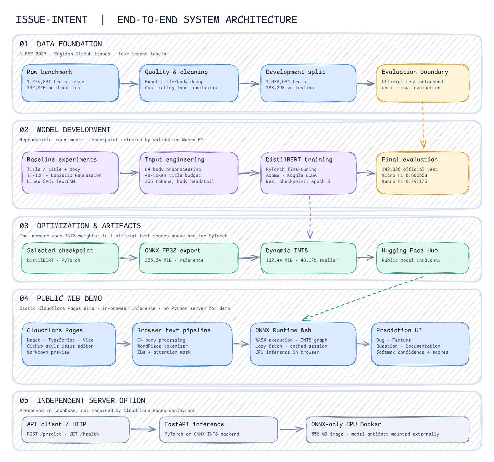

# issue-intent

**End-to-end GitHub issue classification with NLP, DistilBERT, and ONNX Runtime Web.**

[](https://issue-intent.pages.dev/)
[](https://huggingface.co/mazenalasas/issue-intent-onnx)
[](https://github.com/nlbse2023/issue-report-classification)

## Overview

**issue-intent** predicts the intent of an English GitHub issue from its title and description. It assigns one of four labels: **`bug`**, **`feature`**, **`question`**, or **`documentation`**.

The project covers the complete applied NLP workflow: auditing and preparing real-world issue reports, establishing evaluation protocols, comparing classical and neural baselines, fine-tuning DistilBERT, evaluating on the held-out test set, exporting and quantizing the model to ONNX, and shipping an interactive browser-only demo.

The live application uses a GitHub-inspired React editor and runs **ONNX INT8 inference locally in the browser**. Cloudflare Pages serves the frontend; Hugging Face hosts the model weights. A separate FastAPI/ONNX Docker serving path is also implemented in this repository.

## Live Demo

**[Try the interactive demo](https://issue-intent.pages.dev/)** · **[Explore the hosted ONNX model](https://huggingface.co/mazenalasas/issue-intent-onnx)**

**Demo Video**

> The first browser prediction requires downloading the ~132 MiB ONNX model. Subsequent predictions can reuse browser caching and the initialized inference session. The demo does not create or modify GitHub issues.

## Results

The selected **PyTorch DistilBERT checkpoint** achieved the following results on the **official held-out NLBSE'23 test set (142,320 issues)**:

| Model | Split | Micro F1 | Macro F1 |
| --- | --- | ---: | ---: |
| TF-IDF + Logistic Regression | Validation | 0.842650 | 0.706409 |
| TextCNN | Validation | 0.852650 | 0.724730 |
| DistilBERT | Validation | 0.883665 | 0.788362 |
| **DistilBERT (selected PyTorch checkpoint)** | **Official test** | **0.886558** | **0.791175** |

The development results above are **validation** scores and should not be compared as if they were measured on the official test split. The deployed **ONNX INT8** model was separately evaluated on the first **14,040 official-test examples** (a non-random 9.87% subset): **0.881339 Micro F1** and **0.781291 Macro F1**. These are partial evaluation results, not full-test scores for the deployed model.

For methods, per-class results, the confusion matrix, and evaluation boundaries, see the [Final Evaluation Report](docs/FINAL_EVALUATION_REPORT.md), [Model Card](docs/MODEL_CARD.md), and [ONNX INT8 Report](docs/ONNX_INT8_REPORT.md).

## Dataset

This project uses the [NLBSE'23 Issue Report Classification dataset](https://github.com/nlbse2023/issue-report-classification), consisting of real GitHub issues labeled by intent.

| Dataset stage | Issues |
| --- | ---: |
| Original official training set | 1,275,881 |
| Official held-out test set | 142,320 |
| Total source dataset | **1,418,201** |
| Prepared development pool | 1,221,982 |
| Training split | 1,038,684 |
| Validation split | 183,298 |

Data preparation handles missing text fields, removes identical title/body examples with consistent labels, and excludes exact-text groups with conflicting labels. The prepared data uses a **stratified 85/15 train/validation split** with `random_state=42`; the official test set was kept separate for final evaluation. Raw data and generated training artifacts are not committed to Git.

## Architecture

The architecture covers the data preparation, model experimentation and evaluation, ONNX conversion, browser deployment, and the independent API serving path.



At runtime, the browser loads the static React application from Cloudflare Pages, downloads the ONNX INT8 model from Hugging Face, and executes predictions using **ONNX Runtime Web (WASM)**. Inference does not require a running Python backend.

## Tech Stack

| Area | Technologies |
| --- | --- |
| **Data & analysis** | Python, Pandas, NumPy, DuckDB, PyArrow, Jupyter, Seaborn |
| **Classical ML** | scikit-learn, TF-IDF, Logistic Regression, LinearSVC |
| **Deep learning & NLP** | PyTorch, Hugging Face Transformers, DistilBERT, TextCNN |
| **Optimization & inference** | ONNX, ONNX Runtime, ONNX Runtime Web (WASM), INT8 quantization |
| **Backend & packaging** | FastAPI, Uvicorn, Docker |
| **Frontend** | React, TypeScript, Vite, Markdown rendering |
| **Deployment & hosting** | Cloudflare Pages, Hugging Face Hub |
| **Engineering & testing** | Git, GitHub Actions, uv, Ruff, pytest, ESLint, Prettier, Vitest |

## Project Structure

```plaintext
issue-intent/
├── .github/
│   └── workflows/
│       └── ci.yml                 # Python and frontend quality checks
├── docs/                          # Reports, model card, deployment guides
│   ├── FINAL_EVALUATION_REPORT.md
│   ├── MODEL_CARD.md
│   ├── ONNX_INT8_REPORT.md
│   └── STATIC_DEPLOYMENT.md
├── frontend/                      # React + TypeScript browser application
│   ├── public/models/tokenizer/   # Browser tokenizer assets
│   ├── scripts/                   # Static deployment preparation
│   └── src/
│       ├── browser/               # E4 preprocessing, encoding, ONNX inference
│       └── features/              # Issue editor and prediction UI
├── notebooks/                     # Data exploration and preprocessing audits
├── scripts/                       # ONNX export, benchmarks, validation
├── src/
│   ├── api/                       # FastAPI and CPU/ONNX inference
│   ├── data/                      # Data preparation, splits, datasets
│   ├── models/                    # Training, evaluation, model experiments
│   └── preprocessing/             # Structured text preprocessing
├── tests/                         # Python test suite
├── .gitignore
├── LICENSE
├── Dockerfile
├── pyproject.toml
├── uv.lock
└── README.md
```

The tree shows the main components rather than every implementation file. Dataset archives, training checkpoints, and generated model artifacts are intentionally stored outside the repository.

## Getting Started

### Option A — Run the browser demo locally (recommended)

**Requirements:** Git and a recent Node.js version compatible with this project's Vite setup.

1. **Clone the repository:**

   ```bash
   git clone https://github.com/mazen-alasas/issue-intent.git
   ```

2. **Navigate to the frontend directory:**

   ```bash
   cd issue-intent/frontend
   ```

3. **Install dependencies:**

   ```bash
   npm ci
   ```

4. **Start the development server:**

   ```bash
   VITE_INFERENCE_BACKEND=browser \
   VITE_BROWSER_MODEL_URL=https://huggingface.co/mazenalasas/issue-intent-onnx/resolve/main/model_int8.onnx \
   npm run dev
   ```

5. **Open the local URL printed by Vite**, typically `http://localhost:5173/`, and submit an issue title or description to analyze.

The explicit environment variables are important: the code otherwise defaults to API mode and a local ONNX file in development. Browser inference downloads the public model from Hugging Face; **you do not need to start FastAPI or download the training dataset**. Tokenizer assets are included in `frontend/public/models/tokenizer/`.

### Option B — Verify a production-style static build

```bash
cd issue-intent/frontend
npm run build
node scripts/prepare-static-deploy.mjs
npm run preview -- --host 127.0.0.1
```

The preview is normally available at `http://127.0.0.1:4173/`. For the separate FastAPI backend, checkpoint configuration, and ONNX-only Docker image, see the [Frontend Guide](frontend/README.md) and [Docker Deployment Guide](docs/DOCKER_DEPLOYMENT.md).

## Validation & Deployment

| Check | Recorded evidence |
| --- | --- |
| Python test suite | **372 tests passed** |
| Frontend test suite | **19 Vitest tests passed** |
| Code quality | Ruff, ESLint, and frontend formatting checks passed locally |
| Browser ONNX compatibility | 3/3 reference cases matched expected labels |
| Browser preprocessing/tokenization | 3/3 parity fixtures matched Python inputs |
| Production static build | Vite build and static asset validation passed |
| Public demo | Cloudflare Pages deployed; manually smoke-tested on real GitHub issues |

The static deployment excludes the local ONNX weights from Cloudflare assets because the model is fetched from Hugging Face. See the [Browser Compatibility Report](docs/BROWSER_INFERENCE_COMPATIBILITY.md) and [Static Deployment Guide](docs/STATIC_DEPLOYMENT.md) for technical details.

## Documentation

- [Model Card](docs/MODEL_CARD.md) · [Final Evaluation Report](docs/FINAL_EVALUATION_REPORT.md)
- [Experiment Plan](docs/PROJECT_PLAN.md) · [Development Record](docs/PROGRESS.md)
- [ONNX FP32 Report](docs/ONNX_FP32_REPORT.md) · [ONNX INT8 Report](docs/ONNX_INT8_REPORT.md)
- [Browser Compatibility](docs/BROWSER_INFERENCE_COMPATIBILITY.md) · [Static Deployment](docs/STATIC_DEPLOYMENT.md)
- [Docker Deployment](docs/DOCKER_DEPLOYMENT.md) · [HTTP Benchmark](docs/HTTP_BENCHMARK_REPORT.md)

## License & Attribution

The original project source code is licensed under the **[MIT License](LICENSE)**. The [NLBSE'23 dataset and upstream competition repository](https://github.com/nlbse2023/issue-report-classification) and the [DistilBERT base model (Apache-2.0)](https://huggingface.co/distilbert/distilbert-base-uncased) have their own licensing and attribution requirements. The MIT license for this project's original code does **not** relicense the dataset, upstream assets, or trained model weights. See the [hosted model page](https://huggingface.co/mazenalasas/issue-intent-onnx) for the deployed artifact.

## Contact

Created by [Mazen Ahmed Alasas](https://github.com/mazen-alasas) — feel free to reach out!

[](https://www.linkedin.com/in/mazen-ahmed-alasas-772831244/)
[](https://www.youtube.com/@mazen_labs)
